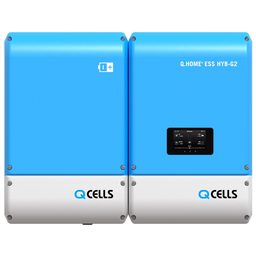

# ioBroker.qhome-ess-hyb-g2

Reads the real-time values of a **Q CELLS Q.HOME+ ESS HYB-G2** home storage system (hybrid inverter with battery,
[Q CELLS](https://www.qcells.com/)) from its local web interface and provides them as states in ioBroker.
On top of that, the adapter counts the energy flows (PV generation, grid purchase and feed-in, battery charge and
discharge, consumption) per day, week, month, quarter, half-year, year and in total.

The storage system is polled locally in the home network (`http://<host>/R3EMSAPP_REAL.ems?file=ESSRealtimeStatus.json`);
no cloud access and no account are required.

A German description is available in [docs/de/README.md](docs/de/README.md).

> **Development note:** This adapter was built with the help of **Claude** (AI by Anthropic, via Claude Code).
> Requirements, testing on a real installation and review of every change are done by the maintainer. Every change
> runs through automated tests (unit, integration and installation tests) before a release is created.

## Installation

Install the adapter like any other adapter from the ioBroker Admin interface (*Adapters*), then create an instance and
enter the hostname or IP address of the storage system.

Requirements: Node.js ≥ 22, js-controller ≥ 6.0.11, Admin ≥ 7.6.20.

## Configuration

| Setting | Description | Default |
|---|---|---|
| ESS hostname / IP address | Hostname or IP address of the storage system | `qhome.local` |
| Battery capacity (kWh) | Usable capacity of the battery | `4` |
| Polling interval (seconds) | Time between two requests (1 … 2,147,483 s) | `1` |
| Additional PV inverters | Power states of further inverters, see below | – |

### Additional PV inverters

Further inverters that are integrated into ioBroker by another adapter (e.g. `sungrow-local.0.inverter.activePower`)
can be entered in a table: state, unit (W or kW) and a name for the log. The adapter subscribes to these states and
adds their power on every request:

- `PvPwExt` is the sum of the additional inverters, `PvPwTotal` = `PvPw` + `PvPwExt`.
- The counters (`PvGen` etc.) use `PvPwTotal`.
- **Consumption:** The Q.HOME meters at the grid connection point and only knows its own PV. It sees the power of
  additional inverters only as lower grid purchase or higher feed-in, so its own consumption value is too low. As soon
  as at least one inverter is configured, the adapter therefore calculates `ConsPw` from the energy balance:
  `PvPwTotal` + grid purchase − feed-in + battery discharge − battery charge.
- Only confirmed values (`ack = true`) are used. Values older than 60 seconds (e.g. at night when the inverter does not
  answer, or when its adapter is stopped) count as 0. If the last value was greater than 0, a warning is logged.

## States

| ID | Description | Unit |
|---|---|---|
| `ColecTm` | Collection time of the values | |
| `PvPw` | PV power of the Q.HOME | kW |
| `PvPwExt` | PV power of the additional inverters | kW |
| `PvPwTotal` | Total PV power (`PvPw` + `PvPwExt`) | kW |
| `ConsPw` | Consumption (with additional inverters calculated from the energy balance) | kW |
| `GridPw` | Grid power | kW |
| `GridStusCd` | Grid status (0 = purchase, 1 = feed-in) | |
| `GridPwPurchase` / `GridPwPurchaseWb` | Grid purchase | kW / W |
| `GridPwFeedIn` / `GridPwFeedInWb` | Grid feed-in | kW / W |
| `BtSoc` | Battery state of charge | % |
| `BtCap` | Energy currently stored in the battery | kWh |
| `BtPw` | Battery power | kW |
| `BtStusCd` | Battery status (0 = discharging, 1 = charging, 2 = idle) | |
| `BtPwCharge` / `BtPwDisCharge` | Battery charging / discharging power | W |
| `BtChargeIndicator` / `BtDisChargeIndicator` | 1 while charging / discharging | |
| `BtLast` | Remaining time until full / empty | min |
| `PcsPw` / `AbsPcsPw` | Inverter power | W / kW |
| `PowerOutletPw`, `OperStusCd`, `EmsOpMode`, `RankPer`, `ErrorCnt` | Raw values of the ESS | |
| `info.connection` | Connection to the ESS | |

## Energy counters

Under `counters.*` the adapter counts the energy for **day, week, month, quarter, half-year, year and total**. The
basis are the polled power values, integrated over the time that actually passed. Gaps of more than 60 seconds (e.g.
when the ESS was not reachable) are not extrapolated.

| Period | Channel | Previous period |
|---|---|---|
| Day | `counters.day` | `counters.day.previous` (yesterday) |
| Week (Mon–Sun, ISO 8601 calendar week) | `counters.week` | `counters.week.previous` |
| Month | `counters.month` | `counters.month.previous` |
| Quarter | `counters.quarter` | `counters.quarter.previous` |
| Half-year | `counters.halfyear` | `counters.halfyear.previous` |
| Year | `counters.year` | `counters.year.previous` |
| Total | `counters.total` | – (never reset) |

Each channel contains:

| ID | Description | Unit |
|---|---|---|
| `PvGen` | PV generation (Q.HOME + additional inverters) | kWh |
| `GridPurchase` | Grid purchase | kWh |
| `GridFeedIn` | Grid feed-in | kWh |
| `BtCharged` | Battery charged | kWh |
| `BtDischarged` | Battery discharged | kWh |
| `Cons` | Consumption | kWh |
| `SelfSupply` | Self-supply (consumption − grid purchase) | kWh |
| `Autarky` | Autarky (self-supply / consumption) | % |
| `SelfConsRate` | Self-consumption rate ((PV − feed-in) / PV) | % |
| `periodKey` | Current period, e.g. `2026-11-10`, `2026-W46`, `2026-Q4`, `2026-H2` | |

A period change is detected on every request, not by a schedule: the previous value moves to `previous` and the
counter starts at 0. This also works if the adapter was not running at the time of the change. If the adapter was
stopped for longer than a whole period, `previous` is set to 0 instead of showing an older period. The counters are
saved every 10 seconds and on shutdown and restored after a restart.

### Recording the history (e.g. SQL)

For long-term history, enable a history adapter (SQL, InfluxDB, History) for the `previous` states. On a period change
the adapter writes every previous-period value **exactly once**, even if it equals the previous one, with the **end of
the elapsed period** as timestamp (e.g. yesterday 23:59:59.999), so the value appears at the correct day, month or year
in charts.

Recommended settings per state (gear icon in the object view):

| Setting | Value |
|---|---|
| Enabled | ✔ |
| Log changes only | **off** – otherwise days with identical values are missing |
| Debounce time | 0 |
| Still log the same values | 0 (off) |
| Storage retention | unlimited |

## Development

See [DEVELOPMENT.md](DEVELOPMENT.md).

## Changelog

<!--
    Placeholder for the next version (at the beginning of the line):
    ### **WORK IN PROGRESS**
-->

### 0.5.0 (2026-11-26)

- (Exc3pt10n) **Breaking:** distributed via npm from now on; installation from GitHub is no longer supported. Install
  the adapter from npm (see [Installation](#installation)); existing instances and their settings are kept.
- (Exc3pt10n) **Breaking:** requires js-controller ≥ 6.0.11 and Admin ≥ 7.6.20.
- (Exc3pt10n) Object names, status texts and log messages in English (object names with German translation); the
  settings page is translated into all ioBroker languages.
- (Exc3pt10n) Power states use the role `value.power`, the stored battery energy `value.energy`.
- (Exc3pt10n) Fixes: the polling interval is checked for its maximum, additional PV inverters only use confirmed
  values (`ack`), possible unhandled error while polling, obsolete states with history settings are kept.

Older changes: [CHANGELOG_OLD.md](CHANGELOG_OLD.md)

## License

MIT License – see [LICENSE](LICENSE).

Copyright (c) 2025-2026 Exc3pt10n <kontakt@jansesoft.de>
