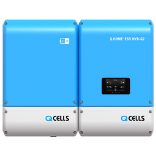

# ioBroker.qhome-ess-hyb-g2 – Beschreibung auf Deutsch

Liest die Echtzeitwerte eines **Q CELLS Q.HOME+ ESS HYB-G2** Heimspeichers (Hybrid-Wechselrichter mit Batterie,
[Q CELLS](https://www.q-cells.de/)) über dessen lokale Web-Schnittstelle aus und stellt sie als Datenpunkte in
ioBroker bereit. Zusätzlich zählt der Adapter die Energieflüsse (PV-Erzeugung, Netzbezug und Einspeisung, Laden und
Entladen der Batterie, Verbrauch) je Tag, Woche, Monat, Quartal, Halbjahr, Jahr und insgesamt.

Der Speicher wird lokal im Heimnetz abgefragt (`http://<host>/R3EMSAPP_REAL.ems?file=ESSRealtimeStatus.json`), ein
Cloud-Zugang oder Konto ist nicht nötig.

Objektnamen, Statustexte und Log-Meldungen sind englisch; die Objektnamen haben eine deutsche Übersetzung, die Admin
bei deutscher Systemsprache anzeigt.

## Installation

Den Adapter in der Admin-Oberfläche unter *Adapter* installieren und eine Instanz anlegen. Solange er nicht im
ioBroker-Repository steht: *Adapter* → *Installieren aus eigener URL* → Reiter *npm* mit dem Paketnamen
`iobroker.qhome-ess-hyb-g2`.

Voraussetzungen: Node.js ≥ 22, js-controller ≥ 6.0.11, Admin ≥ 7.6.20.

## Konfiguration

| Einstellung | Beschreibung | Standard |
|---|---|---|
| ESS Hostname / IP-Adresse | Hostname oder IP des Speichers | `qhome.local` |
| Speicherkapazität (kWh) | Nutzbare Kapazität der Batterie | `4` |
| Abfrageintervall (Sekunden) | Abstand zwischen zwei Abrufen (1 … 2.147.483 s) | `1` |
| Zusätzliche PV-Erzeuger | Leistungs-Datenpunkte weiterer Wechselrichter, siehe unten | – |

### Zusätzliche PV-Erzeuger

Weitere Wechselrichter, die über einen anderen Adapter in ioBroker eingebunden sind
(z. B. `sungrow-local.0.inverter.activePower`), lassen sich in einer Tabelle eintragen:
Datenpunkt, Einheit (W oder kW) und ein Name für das Log. Der Adapter abonniert die
Datenpunkte und rechnet ihre Leistung bei jedem Abruf ein:

- `PvPwExt` ist die Summe der zusätzlichen Erzeuger, `PvPwTotal` = `PvPw` + `PvPwExt`.
- Die Zähler (`PvGen` usw.) verwenden `PvPwTotal`.
- **Verbrauch:** Der Q.HOME misst am Hausanschluss und kennt nur seine eigene PV. Die
  Leistung der zusätzlichen Erzeuger sieht er nur als geringeren Netzbezug bzw. höhere
  Einspeisung, sein eigener Verbrauchswert ist dann zu niedrig. Sobald mindestens ein
  Erzeuger eingetragen ist, berechnet der Adapter `ConsPw` deshalb aus der Energiebilanz:
  `PvPwTotal` + Netzbezug − Einspeisung + Batterie-Entladung − Batterie-Ladung.
- Es zählen nur bestätigte Werte (`ack = true`). Werte, die älter als 60 Sekunden sind (z. B. nachts, wenn der Wechselrichter nicht
  antwortet, oder wenn dessen Adapter ausfällt), zählen als 0. War der letzte Wert
  größer als 0, steht eine Warnung im Log.

## Datenpunkte

| ID | Beschreibung | Einheit |
|---|---|---|
| `ColecTm` | Abfragezeitpunkt (Zeitstempel in ms, Rolle `date`) | ms |
| `PvPw` | Photovoltaikleistung des Q.HOME | kW |
| `PvPwExt` | Photovoltaikleistung der zusätzlichen Erzeuger | kW |
| `PvPwTotal` | Photovoltaikleistung gesamt (`PvPw` + `PvPwExt`) | kW |
| `ConsPw` | Verbrauch (mit zusätzlichen Erzeugern aus der Energiebilanz) | kW |
| `GridPw` | Netzleistung | kW |
| `GridStusCd` | Netzstatus (0 = Bezug, 1 = Einspeisung) | |
| `GridPwPurchase` / `GridPwPurchaseWb` | Netzbezug | kW / W |
| `GridPwFeedIn` / `GridPwFeedInWb` | Netzeinspeisung | kW / W |
| `BtSoc` | Batterie Ladezustand | % |
| `BtCap` | Batterie Kapazität (aktuell gespeicherte Energie) | kWh |
| `BtPw` | Batterieleistung | kW |
| `BtStusCd` | Batteriestatus (0 = Entladen, 1 = Laden, 2 = Ruhe, d. h. weder Laden noch Entladen) | |
| `BtPwCharge` / `BtPwDisCharge` | Lade-/Entladeleistung Batterie | W |
| `BtChargeIndicator` / `BtDisChargeIndicator` | 1, wenn geladen / entladen wird | |
| `BtLast` | Restlaufzeit bis voll / leer | min |
| `PcsPw` / `AbsPcsPw` | Wechselrichterleistung | W / kW |
| `PowerOutletPw`, `OperStusCd`, `EmsOpMode`, `RankPer`, `ErrorCnt` | Rohwerte des ESS | |
| `info.connection` | Verbindung zum ESS | |

## Energiezähler

Unter `counters.*` zählt der Adapter die Energie für **Tag, Woche, Monat, Quartal,
Halbjahr, Jahr und Gesamt**. Grundlage sind die abgerufenen Leistungswerte, integriert über die
tatsächlich vergangene Zeit. Lücken von mehr als 60 Sekunden, zum Beispiel weil das
ESS nicht erreichbar war, werden nicht hochgerechnet.

| Zeitraum | Kanal | Vorzeitraum |
|---|---|---|
| Tag | `counters.day` | `counters.day.previous` (gestern) |
| Woche (Mo–So, KW nach ISO 8601) | `counters.week` | `counters.week.previous` (Vorwoche) |
| Monat | `counters.month` | `counters.month.previous` (Vormonat) |
| Quartal | `counters.quarter` | `counters.quarter.previous` (Vorquartal) |
| Halbjahr | `counters.halfyear` | `counters.halfyear.previous` (Vorhalbjahr) |
| Jahr | `counters.year` | `counters.year.previous` (Vorjahr) |
| Gesamt | `counters.total` | – (wird nie zurückgesetzt) |

Jeder Kanal enthält:

| ID | Beschreibung | Einheit |
|---|---|---|
| `PvGen` | PV-Erzeugung (Q.HOME + zusätzliche Erzeuger) | kWh |
| `GridPurchase` | Netzbezug | kWh |
| `GridFeedIn` | Netzeinspeisung | kWh |
| `BtCharged` | Batterie geladen | kWh |
| `BtDischarged` | Batterie entladen | kWh |
| `Cons` | Verbrauch | kWh |
| `SelfSupply` | Eigenversorgung (Verbrauch − Netzbezug) | kWh |
| `Autarky` | Autarkie (Eigenversorgung / Verbrauch) | % |
| `SelfConsRate` | Eigenverbrauchsquote ((PV − Einspeisung) / PV) | % |
| `periodKey` | aktueller Zeitraum, z. B. `2026-11-10`, `2026-W46`, `2026-Q4`, `2026-H2` | |

Der Zeitraumwechsel wird bei jedem Abruf erkannt, nicht über einen Zeitplan. Der
bisherige Stand wandert dann nach `previous` und der Zähler beginnt bei 0. Das
funktioniert auch, wenn der Adapter zum Wechselzeitpunkt nicht lief. War der Adapter
länger als einen ganzen Zeitraum aus, wird `previous` auf 0 gesetzt, statt einen
älteren Zeitraum als Vorzeitraum anzuzeigen. Die Zählerstände werden alle 10 Sekunden
und beim Beenden gespeichert und nach einem Neustart wieder eingelesen.

### Verlauf aufzeichnen (z. B. SQL)

Für einen Langzeitverlauf aktiviert man für die `previous`-Datenpunkte einen
History-Adapter (SQL, InfluxDB, History). Beim Zeitraumwechsel schreibt der Adapter
jeden Vorzeitraum-Wert **genau einmal**, auch wenn er gleich dem vorherigen ist. Als
Zeitstempel verwendet er das **Ende des abgelaufenen Zeitraums**, zum Beispiel
gestern 23:59:59.999. Dadurch erscheint der Wert im Diagramm beim richtigen Tag,
Monat oder Jahr.

Einstellungen je Datenpunkt (Zahnrad in der Objektansicht):

| Einstellung | Wert |
|---|---|
| Aktiviert | ✔ |
| Nur Änderungen aufzeichnen | **aus**, sonst fehlen Tage mit gleichem Wert |
| Entprellzeit | 0 |
| Gleiche Werte trotzdem aufzeichnen | 0 (aus) |
| Speicherdauer | unbegrenzt |
